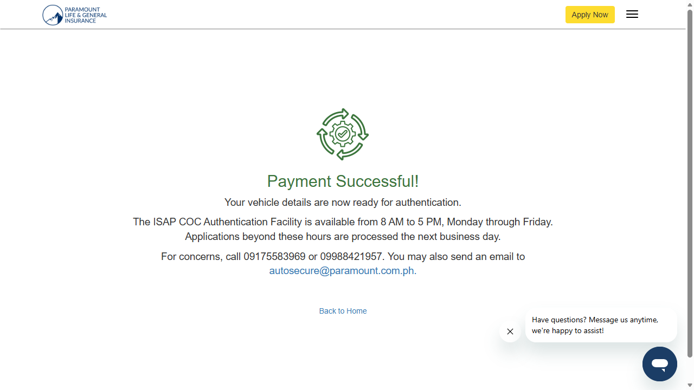
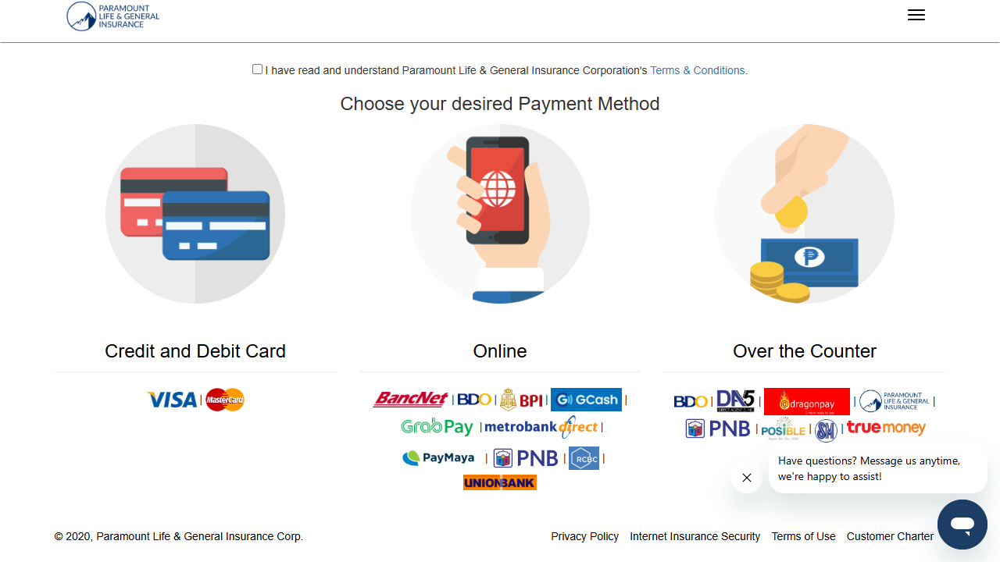

# QB-49 | RD-184 - Set 3 Commercial Vehicle (Truck)

- **Date of testing:** 2026-10-01
- **Environment:** https://ctpl-demo.herokuapp.com
- **Browser:** Microsoft Edge
- **Test Status:** FAILED (5 passed, 1 failed; 6 total)

| # | Scenario | Test Status | Expected Output | System Output | Test Remarks |
|---|---|---|---|---|---|
| 1 | QB-49 E \| Set 3 Commercial Vehicle (Truck) \| COV region (NCR) > CTPL Website - Application Process | PASSED | Application for Set 3 Commercial Vehicle (Truck) in COV region (NCR) completes: no VVIP opt-in prompt, DPA accepted, OTP verified, redirected to payment instructions. | Set 3 Commercial Vehicle (Truck) \| policy=2 mv=9 \| Total Premium shown: 1,320.00 \| expected: 1320.00 / ✅ TEST 1 COMPLETE \| APPLICATION SUBMITTED! | As expected. |
| 2 | QB-49 E \| Set 3 Commercial Vehicle (Truck) \| COV region (NCR) > CTPL Website - BDO Payment Process | PASSED | Payment instructions page proceeds through BDO sandbox payment to a successful payment (screenshot attached). | Reached BDO sandbox success; final URL https://ctpl-demo.herokuapp.com/pay-online/result?requestid=MjYwMDA2ODYzMzE3OTA4MzUzOTAxMA== \| ✅ TEST 2 COMPLETE \| PAYMENT SUCCESSFUL! | As expected. |
| 3 | QB-49 E \| Set 3 Commercial Vehicle (Truck) \| COV region (NCR) > Total Premium matches expected (base + COV fee) | PASSED | Total Premium = one-year base (rate table) + P74 verification fee for COV regions; base only for non-COV regions. | Total Premium shown P1,320.00 (expected P1320.00) | As expected. |
| 4 | QB-49 E \| Set 3 Commercial Vehicle (Truck) \| No-COV region (CAR) > CTPL Website - Application Process | PASSED | Application for Set 3 Commercial Vehicle (Truck) in No-COV region (CAR) completes: no VVIP opt-in prompt, DPA accepted, OTP verified, redirected to payment instructions. | Set 3 Commercial Vehicle (Truck) \| policy=2 mv=9 \| Total Premium shown: 1,320.00 \| expected: 1246.00 / ✅ TEST 1 COMPLETE \| APPLICATION SUBMITTED! | As expected. |
| 5 | QB-49 E \| Set 3 Commercial Vehicle (Truck) \| No-COV region (CAR) > CTPL Website - BDO Payment Process | PASSED | Payment instructions page proceeds through BDO sandbox payment to a successful payment (screenshot attached). | Reached BDO sandbox success; final URL https://ctpl-demo.herokuapp.com/pay-online/result?requestid=MjYwMDA2ODYzNDE3OTA4MzU1NzIxMA== \| ✅ TEST 2 COMPLETE \| PAYMENT SUCCESSFUL! | As expected. |
| 6 | QB-49 E \| Set 3 Commercial Vehicle (Truck) \| No-COV region (CAR) > Total Premium matches expected (base + COV fee) | FAILED | Total Premium = one-year base (rate table) + P74 verification fee for COV regions; base only for non-COV regions. | Total Premium shown P1,320.00 (expected P1246.00) \| Error: expect(received).toBe(expected) // Object.is equality \| Expected: 1246 \| Received: 1320 | FAILED vs QB-49 rule: CAR is not in the COV list, so only the base premium (1246.00) should show. System shows base + P74 (1,320.00). Fee comes from the region config (vvip_agent_regions); CAR is enrolled with P74 in this environment. |

## Screenshots and videos

Files are in the `screenshots/` and `videos/` folders next to this summary.

| Test | Status | File |
|---|---|---|
| QB-49 E \| Set 3 Commercial Vehicle (Truck) \| COV region (NCR) > CTPL Website - Application Process [Microsoft Edge] | passed | [application-submitted](screenshots/01-qb-49-e-set-3-commercial-vehicle-truck-cov-region-ncr-ctpl-website-application-process-microsoft-edge-application-submitted.png) |
| QB-49 E \| Set 3 Commercial Vehicle (Truck) \| COV region (NCR) > CTPL Website - Application Process [Microsoft Edge] | passed | [screenshot](screenshots/02-qb-49-e-set-3-commercial-vehicle-truck-cov-region-ncr-ctpl-website-application-process-microsoft-edge-screenshot.png) |
| QB-49 E \| Set 3 Commercial Vehicle (Truck) \| COV region (NCR) > CTPL Website - BDO Payment Process [Microsoft Edge] | passed | [payment-success](screenshots/03-qb-49-e-set-3-commercial-vehicle-truck-cov-region-ncr-ctpl-website-bdo-payment-process-microsoft-edge-payment-success.png) |
| QB-49 E \| Set 3 Commercial Vehicle (Truck) \| COV region (NCR) > CTPL Website - BDO Payment Process [Microsoft Edge] | passed | [screenshot](screenshots/04-qb-49-e-set-3-commercial-vehicle-truck-cov-region-ncr-ctpl-website-bdo-payment-process-microsoft-edge-screenshot.png) |
| QB-49 E \| Set 3 Commercial Vehicle (Truck) \| COV region (NCR) > Total Premium matches expected (base + COV fee) [Microsoft Edge] | passed | [screenshot](screenshots/05-qb-49-e-set-3-commercial-vehicle-truck-cov-region-ncr-total-premium-matches-expected-base--microsoft-edge-screenshot.png) |
| QB-49 E \| Set 3 Commercial Vehicle (Truck) \| No-COV region (CAR) > CTPL Website - Application Process [Microsoft Edge] | passed | [application-submitted](screenshots/06-qb-49-e-set-3-commercial-vehicle-truck-no-cov-region-car-ctpl-website-application-process-microsoft-edge-application-submitted.png) |
| QB-49 E \| Set 3 Commercial Vehicle (Truck) \| No-COV region (CAR) > CTPL Website - Application Process [Microsoft Edge] | passed | [screenshot](screenshots/07-qb-49-e-set-3-commercial-vehicle-truck-no-cov-region-car-ctpl-website-application-process-microsoft-edge-screenshot.png) |
| QB-49 E \| Set 3 Commercial Vehicle (Truck) \| No-COV region (CAR) > CTPL Website - BDO Payment Process [Microsoft Edge] | passed | [payment-success](screenshots/08-qb-49-e-set-3-commercial-vehicle-truck-no-cov-region-car-ctpl-website-bdo-payment-process-microsoft-edge-payment-success.png) |
| QB-49 E \| Set 3 Commercial Vehicle (Truck) \| No-COV region (CAR) > CTPL Website - BDO Payment Process [Microsoft Edge] | passed | [screenshot](screenshots/09-qb-49-e-set-3-commercial-vehicle-truck-no-cov-region-car-ctpl-website-bdo-payment-process-microsoft-edge-screenshot.png) |
| QB-49 E \| Set 3 Commercial Vehicle (Truck) \| No-COV region (CAR) > Total Premium matches expected (base + COV fee) [Microsoft Edge] | failed | [screenshot](screenshots/10-qb-49-e-set-3-commercial-vehicle-truck-no-cov-region-car-total-premium-matches-expected-ba-microsoft-edge-screenshot.png) |

**QB-49 E \| Set 3 Commercial Vehicle (Truck) \| COV region (NCR) > CTPL Website - Application Process**

**QB-49 E \| Set 3 Commercial Vehicle (Truck) \| COV region (NCR) > CTPL Website - Application Process**

**QB-49 E \| Set 3 Commercial Vehicle (Truck) \| COV region (NCR) > CTPL Website - BDO Payment Process**

**QB-49 E \| Set 3 Commercial Vehicle (Truck) \| COV region (NCR) > CTPL Website - BDO Payment Process**

**QB-49 E \| Set 3 Commercial Vehicle (Truck) \| COV region (NCR) > Total Premium matches expected (base + COV fee)**

**QB-49 E \| Set 3 Commercial Vehicle (Truck) \| No-COV region (CAR) > CTPL Website - Application Process**

**QB-49 E \| Set 3 Commercial Vehicle (Truck) \| No-COV region (CAR) > CTPL Website - Application Process**

**QB-49 E \| Set 3 Commercial Vehicle (Truck) \| No-COV region (CAR) > CTPL Website - BDO Payment Process**

**QB-49 E \| Set 3 Commercial Vehicle (Truck) \| No-COV region (CAR) > CTPL Website - BDO Payment Process**

**QB-49 E \| Set 3 Commercial Vehicle (Truck) \| No-COV region (CAR) > Total Premium matches expected (base + COV fee)**

