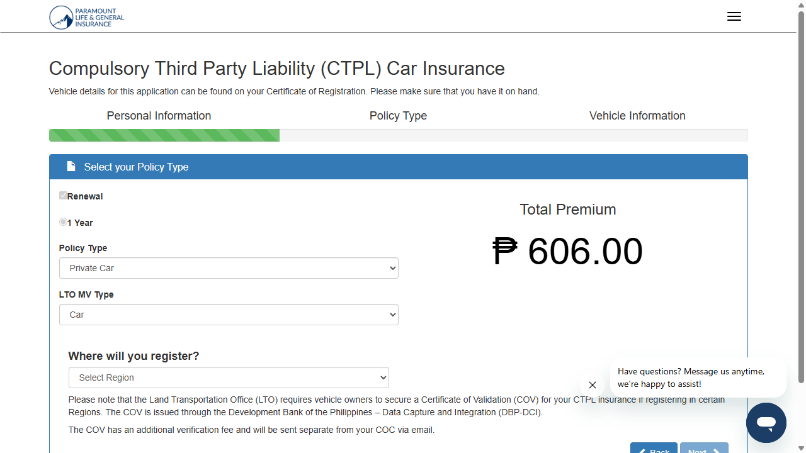
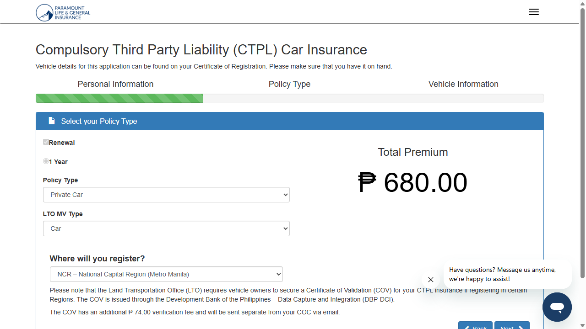

# QB-49 | RD-184 - CTPL COV charge (+P74) premium proof

- **Date of testing:** 2026-10-13
- **Environment:** https://ctpl-demo.herokuapp.com
- **Browsers:** Google Chrome, Microsoft Edge
- **Spec:** `tests/ctpl_appform.spec.ts` (website-form-automation)
- **Result:** 22 passed, 2 failed (24 total). Both failures are the all-regions check, for the same three regions (see Findings).

Every premium shown below is a screenshot of the policy step taken by the test itself. Files are in `screenshots/` and `videos/` next to this summary; raw results are in `data/`.

## 1. End-to-end: Private Car (application, OTP, submit, BDO payment)

| Browser | Application | Premium before region | Premium with region (NCR) | Payment |
|---|---|---|---|---|
| Google Chrome | #945926 | [P606.00](screenshots/Google-Chrome_e2e-1-private-car-base-606.png) | [P680.00](screenshots/Google-Chrome_e2e-2-private-car-with-region-680.png) | PASSED - [result](screenshots/Google-Chrome_e2e-6-payment-result.png) |
| Microsoft Edge | #945927 | [P606.00](screenshots/Microsoft-Edge_e2e-1-private-car-base-606.png) | [P680.00](screenshots/Microsoft-Edge_e2e-2-private-car-with-region-680.png) | PASSED - [result](screenshots/Microsoft-Edge_e2e-6-payment-result.png) |

Other captures per browser: review page premium (`e2e-3`), payment instructions (`e2e-4`), payment page (`e2e-5`), and a video of the whole flow (`e2e-flow-video.webm`).

**Google Chrome: Private Car base 606.00**

**Google Chrome: with region NCR 680.00 (606.00 + 74.00)**

**Microsoft Edge: Private Car base 606.00**

**Microsoft Edge: with region NCR 680.00 (606.00 + 74.00)**

## 2. Base premium + P74 per vehicle type (region: NCR)

Base premium is read from the site; the total must equal base + 74.00 after a region is selected.

| Policy / MV type | Base | + COV | Total | Chrome | Edge |
|---|---|---|---|---|---|
| Private Car / Car | 606.00 | 74.00 | 680.00 | PASS [base](screenshots/Google-Chrome-Private-Car-Car_1-base.png) / [with region](screenshots/Google-Chrome-Private-Car-Car_2-with-region.png) | PASS [base](screenshots/Microsoft-Edge-Private-Car-Car_1-base.png) / [with region](screenshots/Microsoft-Edge-Private-Car-Car_2-with-region.png) |
| Commercial Vehicle / Truck | 1246.00 | 74.00 | 1320.00 | PASS [base](screenshots/Google-Chrome-Commercial-Vehicle-Truck_1-base.png) / [with region](screenshots/Google-Chrome-Commercial-Vehicle-Truck_2-with-region.png) | PASS [base](screenshots/Microsoft-Edge-Commercial-Vehicle-Truck_1-base.png) / [with region](screenshots/Microsoft-Edge-Commercial-Vehicle-Truck_2-with-region.png) |
| Commercial Vehicle / Trailer | 296.00 | 74.00 | 370.00 | PASS [base](screenshots/Google-Chrome-Commercial-Vehicle-Trailer_1-base.png) / [with region](screenshots/Google-Chrome-Commercial-Vehicle-Trailer_2-with-region.png) | PASS [base](screenshots/Microsoft-Edge-Commercial-Vehicle-Trailer_1-base.png) / [with region](screenshots/Microsoft-Edge-Commercial-Vehicle-Trailer_2-with-region.png) |
| Commercial Vehicle / Utility Vehicle | 656.00 | 74.00 | 730.00 | PASS [base](screenshots/Google-Chrome-Commercial-Vehicle-Utility-Vehicle_1-base.png) / [with region](screenshots/Google-Chrome-Commercial-Vehicle-Utility-Vehicle_2-with-region.png) | PASS [base](screenshots/Microsoft-Edge-Commercial-Vehicle-Utility-Vehicle_1-base.png) / [with region](screenshots/Microsoft-Edge-Commercial-Vehicle-Utility-Vehicle_2-with-region.png) |
| Commercial Vehicle / Shuttle Bus | 1246.00 | 74.00 | 1320.00 | PASS [base](screenshots/Google-Chrome-Commercial-Vehicle-Shuttle-Bus_1-base.png) / [with region](screenshots/Google-Chrome-Commercial-Vehicle-Shuttle-Bus_2-with-region.png) | PASS [base](screenshots/Microsoft-Edge-Commercial-Vehicle-Shuttle-Bus_1-base.png) / [with region](screenshots/Microsoft-Edge-Commercial-Vehicle-Shuttle-Bus_2-with-region.png) |
| Motorcycle / Motorcycle | 296.00 | 74.00 | 370.00 | PASS [base](screenshots/Google-Chrome-Motorcycle-Motorcycle_1-base.png) / [with region](screenshots/Google-Chrome-Motorcycle-Motorcycle_2-with-region.png) | PASS [base](screenshots/Microsoft-Edge-Motorcycle-Motorcycle_1-base.png) / [with region](screenshots/Microsoft-Edge-Motorcycle-Motorcycle_2-with-region.png) |
| Motorcycle / Motorcycle with Side Car | 296.00 | 74.00 | 370.00 | PASS [base](screenshots/Google-Chrome-Motorcycle-Motorcycle-with-Side-Car_1-base.png) / [with region](screenshots/Google-Chrome-Motorcycle-Motorcycle-with-Side-Car_2-with-region.png) | PASS [base](screenshots/Microsoft-Edge-Motorcycle-Motorcycle-with-Side-Car_1-base.png) / [with region](screenshots/Microsoft-Edge-Motorcycle-Motorcycle-with-Side-Car_2-with-region.png) |
| Motorcycle / Tricycle | 296.00 | 74.00 | 370.00 | PASS [base](screenshots/Google-Chrome-Motorcycle-Tricycle_1-base.png) / [with region](screenshots/Google-Chrome-Motorcycle-Tricycle_2-with-region.png) | PASS [base](screenshots/Microsoft-Edge-Motorcycle-Tricycle_1-base.png) / [with region](screenshots/Microsoft-Edge-Motorcycle-Tricycle_2-with-region.png) |
| Motorcycle / Non-Conventional MV | 296.00 | 74.00 | 370.00 | PASS [base](screenshots/Google-Chrome-Motorcycle-Non-Conventional-MV_1-base.png) / [with region](screenshots/Google-Chrome-Motorcycle-Non-Conventional-MV_2-with-region.png) | PASS [base](screenshots/Microsoft-Edge-Motorcycle-Non-Conventional-MV_1-base.png) / [with region](screenshots/Microsoft-Edge-Motorcycle-Non-Conventional-MV_2-with-region.png) |

## 3. Premium for every region (Private Car / Car, base 606.00)

Rule used by the QB-49 spec: CAR, Region I and BARMM are not in the COV list (base only, 606.00); every other region adds P74 (680.00).

| # | Region | Expected | Shown | Result | Chrome | Edge |
|---|---|---|---|---|---|---|
| 01 | NCR – National Capital Region (Metro Manila) | P680.00 | P680.00 | PASSED | [screenshot](screenshots/Google-Chrome_region-01-NCR-National-Capital-Region-Metro-Manila-.png) | [screenshot](screenshots/Microsoft-Edge_region-01-NCR-National-Capital-Region-Metro-Manila-.png) |
| 02 | CAR – Cordillera Administrative Region | P606.00 | P680.00 | FAILED | [screenshot](screenshots/Google-Chrome_region-02-CAR-Cordillera-Administrative-Region.png) | [screenshot](screenshots/Microsoft-Edge_region-02-CAR-Cordillera-Administrative-Region.png) |
| 03 | Region I – Ilocos Region | P606.00 | P680.00 | FAILED | [screenshot](screenshots/Google-Chrome_region-03-Region-I-Ilocos-Region.png) | [screenshot](screenshots/Microsoft-Edge_region-03-Region-I-Ilocos-Region.png) |
| 04 | Region II – Cagayan Valley | P680.00 | P680.00 | PASSED | [screenshot](screenshots/Google-Chrome_region-04-Region-II-Cagayan-Valley.png) | [screenshot](screenshots/Microsoft-Edge_region-04-Region-II-Cagayan-Valley.png) |
| 05 | Region III – Central Luzon | P680.00 | P680.00 | PASSED | [screenshot](screenshots/Google-Chrome_region-05-Region-III-Central-Luzon.png) | [screenshot](screenshots/Microsoft-Edge_region-05-Region-III-Central-Luzon.png) |
| 06 | Region IV-A – CALABARZON | P680.00 | P680.00 | PASSED | [screenshot](screenshots/Google-Chrome_region-06-Region-IV-A-CALABARZON.png) | [screenshot](screenshots/Microsoft-Edge_region-06-Region-IV-A-CALABARZON.png) |
| 07 | Region IV-B – MIMAROPA | P680.00 | P680.00 | PASSED | [screenshot](screenshots/Google-Chrome_region-07-Region-IV-B-MIMAROPA.png) | [screenshot](screenshots/Microsoft-Edge_region-07-Region-IV-B-MIMAROPA.png) |
| 08 | Region V – Bicol Region | P680.00 | P680.00 | PASSED | [screenshot](screenshots/Google-Chrome_region-08-Region-V-Bicol-Region.png) | [screenshot](screenshots/Microsoft-Edge_region-08-Region-V-Bicol-Region.png) |
| 09 | Region VI – Western Visayas | P680.00 | P680.00 | PASSED | [screenshot](screenshots/Google-Chrome_region-09-Region-VI-Western-Visayas.png) | [screenshot](screenshots/Microsoft-Edge_region-09-Region-VI-Western-Visayas.png) |
| 10 | Region VII – Central Visayas | P680.00 | P680.00 | PASSED | [screenshot](screenshots/Google-Chrome_region-10-Region-VII-Central-Visayas.png) | [screenshot](screenshots/Microsoft-Edge_region-10-Region-VII-Central-Visayas.png) |
| 11 | Region VIII – Eastern Visayas | P680.00 | P680.00 | PASSED | [screenshot](screenshots/Google-Chrome_region-11-Region-VIII-Eastern-Visayas.png) | [screenshot](screenshots/Microsoft-Edge_region-11-Region-VIII-Eastern-Visayas.png) |
| 12 | NIR – Negros Island Region | P680.00 | P680.00 | PASSED | [screenshot](screenshots/Google-Chrome_region-12-NIR-Negros-Island-Region.png) | [screenshot](screenshots/Microsoft-Edge_region-12-NIR-Negros-Island-Region.png) |
| 13 | Region IX – Zamboanga Peninsula | P680.00 | P680.00 | PASSED | [screenshot](screenshots/Google-Chrome_region-13-Region-IX-Zamboanga-Peninsula.png) | [screenshot](screenshots/Microsoft-Edge_region-13-Region-IX-Zamboanga-Peninsula.png) |
| 14 | Region X – Northern Mindanao | P680.00 | P680.00 | PASSED | [screenshot](screenshots/Google-Chrome_region-14-Region-X-Northern-Mindanao.png) | [screenshot](screenshots/Microsoft-Edge_region-14-Region-X-Northern-Mindanao.png) |
| 15 | Region XI – Davao Region | P680.00 | P680.00 | PASSED | [screenshot](screenshots/Google-Chrome_region-15-Region-XI-Davao-Region.png) | [screenshot](screenshots/Microsoft-Edge_region-15-Region-XI-Davao-Region.png) |
| 16 | Region XII – SOCCSKSARGEN | P680.00 | P680.00 | PASSED | [screenshot](screenshots/Google-Chrome_region-16-Region-XII-SOCCSKSARGEN.png) | [screenshot](screenshots/Microsoft-Edge_region-16-Region-XII-SOCCSKSARGEN.png) |
| 17 | Region XIII – Caraga | P680.00 | P680.00 | PASSED | [screenshot](screenshots/Google-Chrome_region-17-Region-XIII-Caraga.png) | [screenshot](screenshots/Microsoft-Edge_region-17-Region-XIII-Caraga.png) |
| 18 | BARMM – Bangsamoro Autonomous Region in Muslim Mindanao | P606.00 | P680.00 | FAILED | [screenshot](screenshots/Google-Chrome_region-18-BARMM-Bangsamoro-Autonomous-Region-in-Muslim-Mindanao.png) | [screenshot](screenshots/Microsoft-Edge_region-18-BARMM-Bangsamoro-Autonomous-Region-in-Muslim-Mindanao.png) |

## Findings

- **FAILED (both browsers):** CAR, Region I and BARMM show P680.00 (base + P74) but are not in the COV list, so they should show the base premium P606.00. The region fee comes from the region configuration in this environment. This is the same finding as the 2026-10-01 run.
- Note: the Jira text lists the COV regions as NCR and Regions 2, 3, 4A, 4B, 5, 6, 7, 8, 9, 10, 11, 12. It does not list NIR or Region XIII, which the QB-49 spec treats as COV. Both show P680.00 here.
- For the vehicle-type checks, only NCR was selected. All 9 types add exactly P74 (606 -> 680, 1,246 -> 1,320, 656 -> 730, 296 -> 370).

## Videos

- [Google-Chrome-Commercial-Vehicle-Shuttle-Bus.webm](videos/Google-Chrome-Commercial-Vehicle-Shuttle-Bus.webm)
- [Google-Chrome-Commercial-Vehicle-Trailer.webm](videos/Google-Chrome-Commercial-Vehicle-Trailer.webm)
- [Google-Chrome-Commercial-Vehicle-Truck.webm](videos/Google-Chrome-Commercial-Vehicle-Truck.webm)
- [Google-Chrome-Commercial-Vehicle-Utility-Vehicle.webm](videos/Google-Chrome-Commercial-Vehicle-Utility-Vehicle.webm)
- [Google-Chrome-Motorcycle-Motorcycle-with-Side-Car.webm](videos/Google-Chrome-Motorcycle-Motorcycle-with-Side-Car.webm)
- [Google-Chrome-Motorcycle-Motorcycle.webm](videos/Google-Chrome-Motorcycle-Motorcycle.webm)
- [Google-Chrome-Motorcycle-Non-Conventional-MV.webm](videos/Google-Chrome-Motorcycle-Non-Conventional-MV.webm)
- [Google-Chrome-Motorcycle-Tricycle.webm](videos/Google-Chrome-Motorcycle-Tricycle.webm)
- [Google-Chrome-Private-Car-Car.webm](videos/Google-Chrome-Private-Car-Car.webm)
- [Google-Chrome_regions-video.webm](videos/Google-Chrome_regions-video.webm)
- [Microsoft-Edge-Commercial-Vehicle-Shuttle-Bus.webm](videos/Microsoft-Edge-Commercial-Vehicle-Shuttle-Bus.webm)
- [Microsoft-Edge-Commercial-Vehicle-Trailer.webm](videos/Microsoft-Edge-Commercial-Vehicle-Trailer.webm)
- [Microsoft-Edge-Commercial-Vehicle-Truck.webm](videos/Microsoft-Edge-Commercial-Vehicle-Truck.webm)
- [Microsoft-Edge-Commercial-Vehicle-Utility-Vehicle.webm](videos/Microsoft-Edge-Commercial-Vehicle-Utility-Vehicle.webm)
- [Microsoft-Edge-Motorcycle-Motorcycle-with-Side-Car.webm](videos/Microsoft-Edge-Motorcycle-Motorcycle-with-Side-Car.webm)
- [Microsoft-Edge-Motorcycle-Motorcycle.webm](videos/Microsoft-Edge-Motorcycle-Motorcycle.webm)
- [Microsoft-Edge-Motorcycle-Non-Conventional-MV.webm](videos/Microsoft-Edge-Motorcycle-Non-Conventional-MV.webm)
- [Microsoft-Edge-Motorcycle-Tricycle.webm](videos/Microsoft-Edge-Motorcycle-Tricycle.webm)
- [Microsoft-Edge-Private-Car-Car.webm](videos/Microsoft-Edge-Private-Car-Car.webm)
- [Microsoft-Edge_regions-video.webm](videos/Microsoft-Edge_regions-video.webm)
